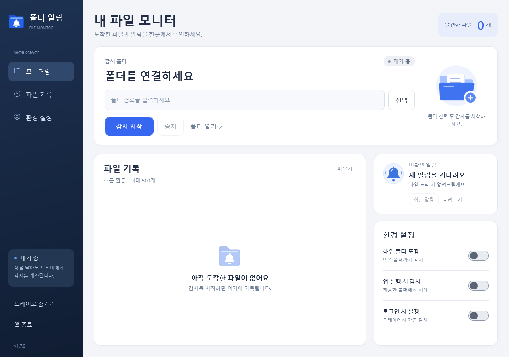
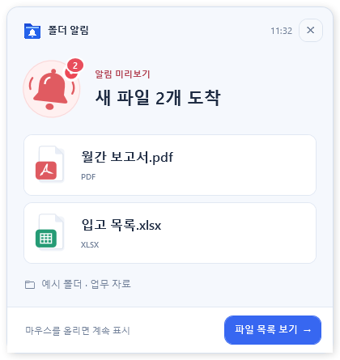
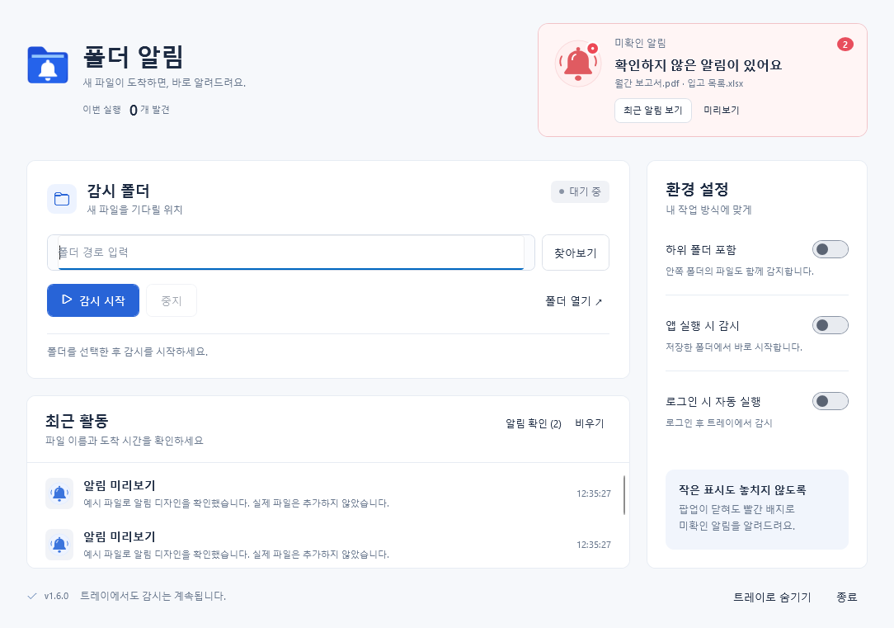
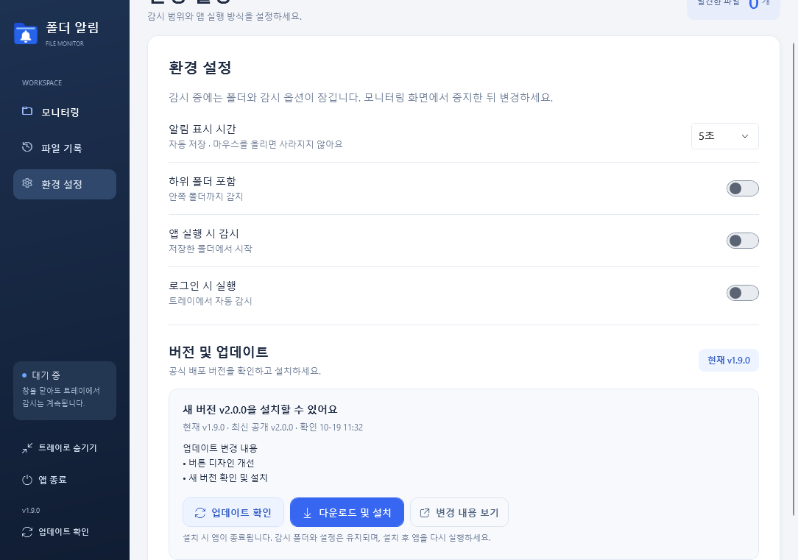

<p align="center">
  
</p>

<h1 align="center">폴더 알림</h1>

<p align="center">
  <strong>새 파일이 도착하면, 바로 알려드려요.</strong><br />
  공유 폴더와 업무 폴더의 새 파일을 팝업·트레이 배지·활동 기록으로 확인하는 Windows 앱
</p>

<p align="center">
  
  
  
  
  <a href="https://github.com/SCOTT0318/folder-notifier/releases/latest"></a>
</p>

<p align="center">
  <a href="https://github.com/SCOTT0318/folder-notifier/releases/latest/download/FolderNotifier-Setup.exe"></a>
  &nbsp;·&nbsp;
  <a href="https://github.com/SCOTT0318/folder-notifier/releases/latest">공개 릴리스</a>
  &nbsp;·&nbsp;
  <a href="https://github.com/SCOTT0318/folder-notifier/releases/latest/download/FolderNotifier-Setup.sha256">SHA-256</a>
</p>

<p align="center"><sub>설치 EXE 하나 · 약 52 MiB · .NET 별도 설치 불필요 · 현재 사용자 전용 설치</sub></p>

---

> [!NOTE]
> **소스와 공개 설치본의 버전을 확인하세요.** 2026-10-19 기준 이 저장소의 소스와 로컬 설치 검증 버전은 **v1.9.0**, GitHub의 최신 공개 설치본은 **v1.2.0**입니다. 위 다운로드는 최신 공개 릴리스를 가리킵니다. 아래의 버튼 디자인과 앱 내부 업데이트 기능은 v1.9.0 기준이며, v1.9.0 설치본은 아직 GitHub Releases에 게시하지 않았습니다.

<p align="center">
  <a href="#주요-기능">주요 기능</a> &nbsp;·&nbsp;
  <a href="#설치와-사용">설치와 사용</a> &nbsp;·&nbsp;
  <a href="#업데이트와-제거">업데이트</a> &nbsp;·&nbsp;
  <a href="#동작-기준">동작 기준</a> &nbsp;·&nbsp;
  <a href="#개발과-빌드">개발과 빌드</a>
</p>

## 한눈에 보는 작업 공간

<p align="center">
  
</p>

감시 폴더, 도착한 파일, 미확인 알림을 한 화면에서 확인합니다. **모니터링 / 파일 기록 / 환경 설정** 메뉴를 전환해도 감시와 기록은 유지됩니다.

## 주요 기능

<table>
  <tr>
    <td width="50%" valign="top"><strong>⚡ 실시간 파일 감지</strong><br />Windows 파일 생성·이름 변경 이벤트를 받아 알립니다. 누락 복구를 위해 30초마다 다시 확인합니다.</td>
    <td width="50%" valign="top"><strong>🔔 파일명이 보이는 알림</strong><br />팝업에 최대 3개 파일을 개별 카드로 표시하고 나머지 수량을 안내합니다. 파일 유형별 그래픽을 제공합니다.</td>
  </tr>
  <tr>
    <td valign="top"><strong>✓ 놓치지 않는 미확인 표시</strong><br />팝업이 닫혀도 트레이·작업표시줄 배지와 알림 카드가 남습니다. 최근 알림을 다시 열어 확인할 수 있습니다.</td>
    <td valign="top"><strong>◉ 구분하기 쉬운 작업 버튼</strong><br />시작은 파란색, 중지는 붉은색으로 구분합니다. 알림 확인·비우기도 배경·테두리·아이콘이 보이는 버튼입니다.</td>
  </tr>
  <tr>
    <td valign="top"><strong>↻ 버전 확인과 설치</strong><br />현재·최신 정식 버전과 변경 내용을 확인합니다. 진행률·취소·SHA-256 검증을 지원하고 이전 버전 설치는 막습니다.</td>
    <td valign="top"><strong>▣ 트레이에서 계속 감시</strong><br />창을 닫아도 감시를 유지합니다. 하위 폴더, 로그인 자동 실행, 앱 실행 시 감시, 네트워크 연결 복구를 지원합니다.</td>
  </tr>
</table>

<details>
<summary><strong>전체 기능 자세히 보기</strong></summary>

- **눈에 보이는 작업 버튼**: 감시 시작은 파란색, 중지는 붉은색, 폴더 선택과 알림 확인은 연한 파란색 버튼으로 구분합니다. 비우기와 알림 확인은 파일 기록 상단에서 배경·테두리·아이콘이 항상 보이며, 미확인 알림이 없을 때 알림 확인은 비활성화됩니다.
- **버전 확인과 업데이트 설치**: 왼쪽 아래 **업데이트 확인** 또는 **환경 설정 → 버전 및 업데이트**에서 현재 버전, 최신 정식 버전, 변경 내용을 확인합니다. 새 버전이 있으면 **다운로드 및 설치**로 진행할 수 있습니다. 다운로드 진행률과 취소를 제공하며, 공식 배포 파일의 크기와 SHA-256을 검증한 후 설치기를 엽니다. 현재와 같거나 낮은 버전은 설치하지 않습니다.
- **실시간 새 파일 알림**: Windows 파일 생성·이름 변경 이벤트를 받아 바로 확인하고 알립니다. 연속 이벤트는 약 0.1초 동안 묶습니다.
- **파일명 중심 알림**: 추가된 파일 이름과 확장자를 개별 행으로 표시합니다. 최대 3개를 미리 보여주고 나머지 수량과 감시 폴더 위치를 함께 안내합니다. 긴 이름은 줄바꿈하며 마우스를 올리면 전체 경로를 확인할 수 있습니다.
- **미확인 알림 배지**: 팝업이 닫힌 뒤에도 트레이의 빨간 배지와 작업표시줄의 알림 수를 유지합니다. 앱을 다시 열거나 **알림 확인**을 누르면 지워집니다.
- **미확인 알림 카드**: 메인 화면 오른쪽에 종 그래픽, 빨간 수량 배지, 파일명 요약을 표시합니다. **최근 알림**으로 마지막 알림을 다시 열 수 있으며 미확인 수는 늘리지 않습니다.
- **그래픽 파일 카드**: 팝업과 활동 목록에서 PDF·스프레드시트·이미지·압축·일반 문서를 서로 다른 색과 그림으로 구분합니다. 알림 도착 시 종 그림이 잠깐 흔들립니다.
- **하위 폴더 감시**: 선택한 폴더 안의 폴더까지 함께 확인합니다.
- **로그인 자동 실행**: 체크하면 다음 Windows 로그인부터 트레이에서 저장된 폴더를 감시합니다.
- **트레이 실행**: 창을 닫아도 계속 감시하고, 트레이 아이콘으로 창을 다시 열 수 있습니다.
- **최근 활동**: 파일별 이력과 감시 상태를 최근 500개까지 표시합니다.
- **연결 복구**: 네트워크 공유 폴더의 연결 / 접근 오류를 표시하고 자동 재시도합니다.
- **메뉴별 화면 전환**: 모니터링은 감시 요약, 파일 기록은 넓은 이력 목록, 환경 설정은 감시·실행 옵션 화면으로 전환합니다. 화면을 바꿔도 감시와 기록은 유지됩니다.
- **부드러운 알림 등장·퇴장**: 팝업이 0.32초 동안 아래에서 올라오며 선명해지고, 닫힐 때는 0.24초 동안 내려가며 흐려집니다. 퇴장 중 새 파일이 도착하면 새 알림으로 자연스럽게 이어집니다.

</details>

### 알림과 미확인 카드

<table>
  <tr>
    <th width="43%">파일 이름을 보여주는 팝업</th>
    <th width="57%">다시 확인할 수 있는 알림 카드</th>
  </tr>
  <tr>
    <td valign="top"></td>
    <td valign="top"></td>
  </tr>
</table>

## 설치와 사용

1. 위의 **Windows 설치 EXE 다운로드**를 눌러 설치 파일을 받습니다.
2. `FolderNotifier-Setup.exe`를 실행하고 설치합니다.
3. 설치 완료 화면 또는 시작 메뉴에서 **폴더 알림**을 엽니다.
4. **선택**으로 감시할 폴더를 지정합니다. 공유 폴더의 UNC 경로도 입력할 수 있습니다.
5. **감시 시작**을 누릅니다.
6. **미리보기**로 알림 표시를 확인합니다.

설치는 현재 사용자에게 적용되며, 관리자 권한을 요청하지 않습니다. 기본 위치는 `%LOCALAPPDATA%\Programs\FolderNotifier`입니다. 바탕 화면 바로가기는 설치 중 선택할 수 있습니다.

> [!IMPORTANT]
> 현재 생성한 설치본에는 코드 서명을 적용하지 않았으므로 Windows에서 게시자 확인 경고가 표시될 수 있습니다. [코드 서명 준비 상태와 발급 조건](installer/SIGNING.md)을 확인하세요.

### 컴퓨터를 켤 때 자동 실행

오른쪽 **환경 설정 → 로그인 시 실행**을 켜세요.

- 변경 즉시 저장되며, 다음 로그인부터 창을 띄우지 않고 트레이에서 감시합니다.
- 체크를 해제하면 자동 실행 등록을 삭제합니다.
- 저장된 폴더가 없으면 로그인 시 폴더를 선택할 수 있도록 창을 표시합니다.
- **앱 실행 시 감시**는 앱을 직접 열었을 때의 별도 옵션입니다.

Windows의 시작 앱 설정에서 별도로 사용 안 함으로 지정했다면 해당 설정에서도 다시 켜야 합니다.

### 숨기기와 종료

**닫기(X)**는 트레이로 숨깁니다. 트레이 아이콘을 두 번 클릭하면 창이 열립니다.
완전히 종료하려면 앱의 **종료** 또는 트레이 메뉴의 **종료**를 선택하세요.

### 업데이트와 제거

**v1.9.0부터** 왼쪽 아래 **업데이트 확인**, 또는 **환경 설정 → 버전 및 업데이트**에서 확인합니다.

| 단계 | 동작 |
| --- | --- |
| **01 · 버전 확인** | 현재 버전·최신 공개 정식 버전·변경 내용을 표시합니다. 같거나 낮은 버전은 설치하지 않습니다. |
| **02 · 다운로드** | 더 높은 버전일 때 **다운로드 및 설치** 버튼을 표시합니다. 다운로드 중에는 감시가 계속되며 취소할 수 있습니다. |
| **03 · 파일 검증** | 공식 배포 파일의 크기와 SHA-256을 확인합니다. 검증에 실패한 파일은 실행하지 않습니다. |
| **04 · 설치·재실행** | 검증 후 설치기를 열고 앱이 설정을 저장한 뒤 감시를 종료합니다. 설치 완료 화면에서 앱을 다시 실행하세요. |

업데이트 확인은 버튼을 눌렀을 때만 공식 GitHub에 접속하며 자동 다운로드·설치는 하지 않습니다. 연결 실패·시간 초과·취소 후에는 다시 시도할 수 있습니다. **설치 중 감시가 중단된 동안 도착한 파일은 재실행 시 기존 파일로 처리합니다.**

<details>
<summary><strong>업데이트 화면 예시 보기</strong></summary>



위 화면의 **v2.0.0은 검증용 예시 데이터**이며 실제 공개 릴리스를 뜻하지 않습니다.

</details>

앱 내부 업데이트 기능이 없는 이전 버전은 새 설치본이 공개된 후 설치 EXE를 직접 받아 업데이트하세요. 실행 중인 앱을 트레이에서 종료하고 설치하면 됩니다.
제거는 **Windows 설정 → 앱 → 설치된 앱 → 폴더 알림 → 제거**에서 진행합니다.

폴더와 옵션은 `%LOCALAPPDATA%\FolderNotifier\settings.json`에 저장되며 업데이트 / 제거 시 유지합니다. 제거할 때 해당 설치 경로의 Windows 자동 실행 등록은 삭제합니다.

## 동작 기준

- 최초 감시 시작 시 이미 있던 파일은 알리지 않습니다.
- 파일 내용 수정과 삭제는 알리지 않으며, 이름 변경은 새로운 경로로 간주합니다.
- 여러 파일이 함께 추가되면 알림 하나로 묶고 파일별 이력을 표시합니다.
- 알림은 파일 경로 발견을 의미하며 복사 완료를 보장하지 않습니다.
- 조회 사이에 생겼다가 사라지는 파일은 놓칠 수 있습니다. 큰 폴더나 느린 네트워크에서는 확인 간격이 길어질 수 있습니다.
- 앱이 꺼졌거나 감시가 중지된 동안의 파일은 다음 감시 시작 시 기존 파일로 처리합니다.
- 연결 지점과 심볼릭 링크는 제외합니다. 활동 이력은 앱 종료 시 사라집니다.
- 감시 대상 파일은 수정하지 않습니다.
- 이벤트 감시 중에는 누락 복구를 위해 30초마다 목록을 재확인합니다. 이벤트 연결이 끊기면 2초 간격으로 조회와 재연결을 시도하며 화면에 연결 재시도 상태를 표시합니다.

**미리보기**를 누르면 예시 파일 2개가 실제 파일 감지와 같은 디자인으로 표시됩니다. 실제 파일은 생성하지 않고 발견한 파일 수도 늘리지 않습니다. 팝업은 기본 5초 동안 표시되며 **환경 설정 → 알림 표시 시간**에서 1~5초로 변경할 수 있습니다. 선택한 시간은 바로 저장되며 최근 활동에 미리보기 기록을 남깁니다. 팝업에 마우스를 올리면 자동 닫힘을 잠시 멈춥니다. **파일 목록 보기**로 앱을 열거나 **✕**로 닫을 수 있습니다. 창을 트레이에 숨겨도 팝업은 표시됩니다.

팝업은 앱이 직접 표시하므로 Windows 배너 알림 / 방해 금지 설정의 영향을 받지 않으며, Windows 알림 센터에는 저장되지 않습니다. 여러 알림이 연속으로 발생하면 팝업은 최신 내용으로 갱신되고 파일별 내용은 최근 활동에서 확인할 수 있습니다.

미확인 알림은 트레이 아이콘의 빨간 배지와 툴팁으로 확인합니다. 앱 창이 작업표시줄에 표시되는 동안에는 아이콘에도 알림 수 배지가 붙습니다. 앱으로 돌아오거나 **알림 확인**을 누르면 배지를 지우며 파일 이력은 유지합니다. **비우기**는 배지와 이력을 함께 지웁니다. 테스트 / 오류는 건별, 새 파일은 파일별로 세며 앱 재실행 시 미확인 수는 초기화됩니다.

## 개발과 빌드

Windows와 **.NET 10 SDK**가 필요합니다. C# WPF / .NET 내장 Fluent 테마와 독립 알림 팝업을 사용하며, 트레이 아이콘에는 Windows Forms `NotifyIcon`을 사용합니다.

### v1.9.0 검증 기록

2026-10-19 확인 기준입니다. 자동 검증과 이 PC에서 수행한 실제 재설치 결과를 구분해 기록합니다.

| 범위 | 확인 결과 |
| --- | --- |
| 파일 감시 | **34개 통과** — 생성·이름 변경·하위 폴더·연결 복구 등 |
| 화면·업데이트 통합 | **161개 통과** — 버튼·최소 창 크기·버전 비교·다운로드 검증·취소·실패 처리 등 |
| 설치된 DLL의 트레이·알림 | **40개 통과** — 격리된 임시 폴더의 실제 파일과 Windows 팝업·트레이 배지 확인 |
| 격리 설치·재설치·제거 | **통과** — 자체 포함 설치, 배포 파일 474개 일치, 사용자 설정 유지 |
| 이 PC의 기존 앱 재설치 | **v1.8.1 → v1.9.0 완료** — 설정 파일·로그인 자동 실행 등록 유지, 재실행 후 기존 폴더 감시 재개 |
| 공개 배포·코드 서명 | **v1.9.0 릴리스 게시 및 실제 코드 서명 미완료** |

### 빌드와 검사 명령

저장소 루트에서 PowerShell로 실행합니다.

```powershell
git clone https://github.com/SCOTT0318/folder-notifier.git
cd folder-notifier

# 파일 감시 검증
dotnet run --project FolderNotifier.Tests -c Release -- .

# 화면, 자동 실행 등록 / 해제, 트레이 감시 검증
dotnet build FolderNotifier.UiTests -c Release -m:1 -nr:false
dotnet run --project FolderNotifier.UiTests -c Release --no-build -- .

# 공식 공개 릴리스 연결 확인 — 설치하지 않고 정보만 조회
dotnet run --project FolderNotifier.UiTests -c Release --no-build -- --check-live-update

# 설치된 DLL 그대로: 트레이에 숨긴 뒤 실제 파일 추가 / 팝업 / 빨간 배지 검증
$installedDll = Join-Path $env:LOCALAPPDATA 'Programs\FolderNotifier\FolderNotifier.dll'
dotnet run --project FolderNotifier.AcceptanceTests -c Release -- $installedDll 'dist\tray-acceptance'

# .NET 런타임을 포함한 앱 빌드
.\build.ps1 -SelfContained

# 설치 EXE 빌드
.\build-installer.ps1

# 격리 경로에서 설치 / 재설치 / 제거 및 파일 해시 검증
.\installer\verify-installer.ps1
```

설치기 빌드 시 공식 Inno Setup portable 컴파일러를 프로젝트 내부에 준비하고 다운로드의 SHA-256 / 게시자 서명을 확인합니다. 최초 빌드에는 네트워크 연결이 필요합니다. 동기화 폴더에서 설치 파일이 손상되는 것을 방지하도록 로컬 임시 폴더에서 생성한 뒤 해시를 확인해 복사합니다.

자동 실행 테스트는 전용 테스트 레지스트리 키와 별도 설정 파일을 사용합니다. 업데이트 검증은 가짜 HTTP 응답과 실행하지 않는 예시 설치 파일을 사용하며 실제 앱을 업데이트하지 않습니다. 공식 릴리스 연결은 별도 명령으로 확인합니다. 설치기 자동 검증은 격리 경로에서 진행하며 실제 시작 프로그램 / 바로가기 / 설치 앱 등록과 Windows 재부팅은 테스트에 포함하지 않습니다.

트레이 수용 검증은 설치된 DLL을 직접 불러온 별도 인스턴스에서 임시 파일 3개를 생성합니다. 실제 Windows 팝업 창 표시와 Shell 트레이 아이콘 등록, 빨간 배지 유지 및 확인 후 해제를 검사하며 기존 앱의 감시 폴더와 설정은 변경하지 않습니다. 결과 JSON과 렌더링 미리보기는 지정한 `dist/` 경로에 저장됩니다.

빌드 결과는 `dist/`에 생성되며 Git에 포함하지 않습니다. 배포 EXE는 [GitHub Releases](https://github.com/SCOTT0318/folder-notifier/releases)에서 제공합니다.

[개발 상세](docs/DEVELOPMENT.md) · [설치기 빌드 상세](installer/README.md)

[코드 서명 발급 조건과 빌드 절차](installer/SIGNING.md) — 실제 발급 및 서명 검증 후 서명 배포본을 만들 수 있습니다.

## 프로젝트 구성

| 경로 | 내용 |
| --- | --- |
| `FolderNotifier/` | WPF 화면, 트레이 알림, 설정, Windows 자동 실행, 버전 확인·업데이트 |
| `FolderNotifier.AcceptanceTests/` | 설치 DLL 기반 실제 파일 / Windows 팝업 / 트레이 배지 검증 |
| `FolderNotifier.Core/` | 폴더 파일 목록 비교와 오류 복구 |
| `FolderNotifier.Tests/` | 파일 감시 검증 |
| `FolderNotifier.UiTests/` | 화면·자동 실행·업데이트 통합 검증 |
| `installer/` | 설치 / 제거, 파일 검증, 선택적 코드 서명 지원 |
| `tools/IconBuilder/` | SVG / PNG / 여러 크기 ICO 생성 |
| `docs/` | 화면 미리보기와 개발 문서 |

---

<p align="center">
  <a href="docs/DEVELOPMENT.md">개발 상세</a> &nbsp;·&nbsp;
  <a href="installer/README.md">설치기 빌드</a> &nbsp;·&nbsp;
  <a href="installer/SIGNING.md">코드 서명 준비</a> &nbsp;·&nbsp;
  <a href="https://github.com/SCOTT0318/folder-notifier/releases">GitHub Releases</a>
</p>
